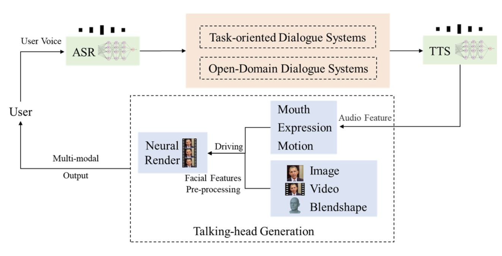
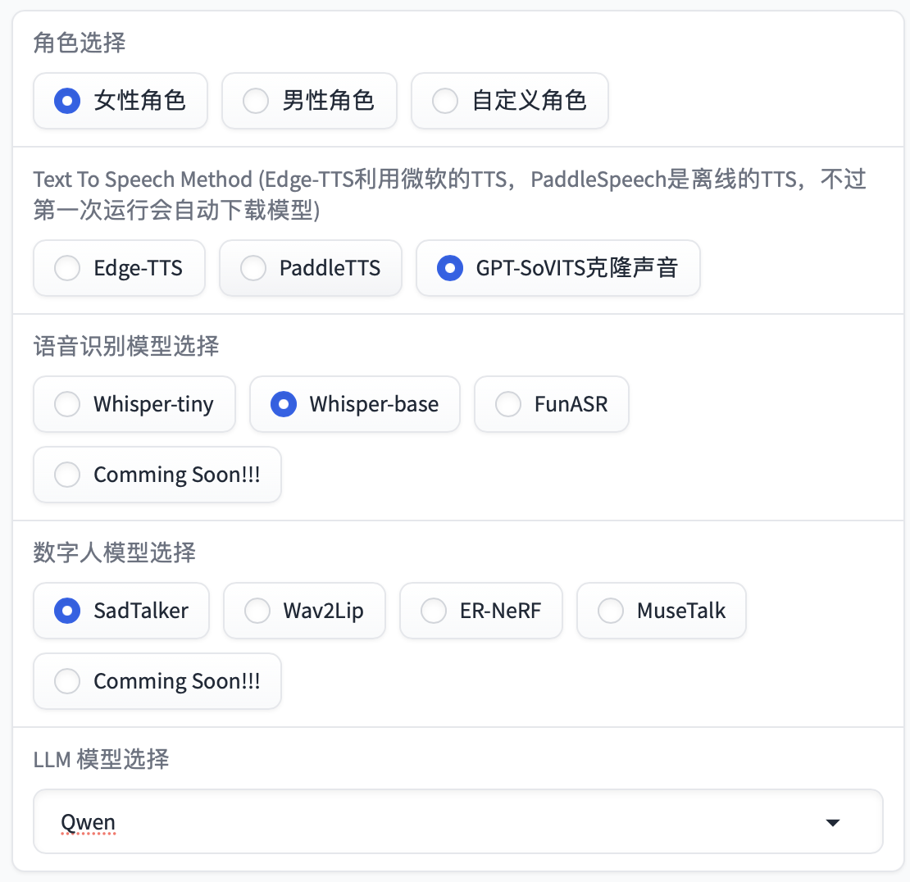
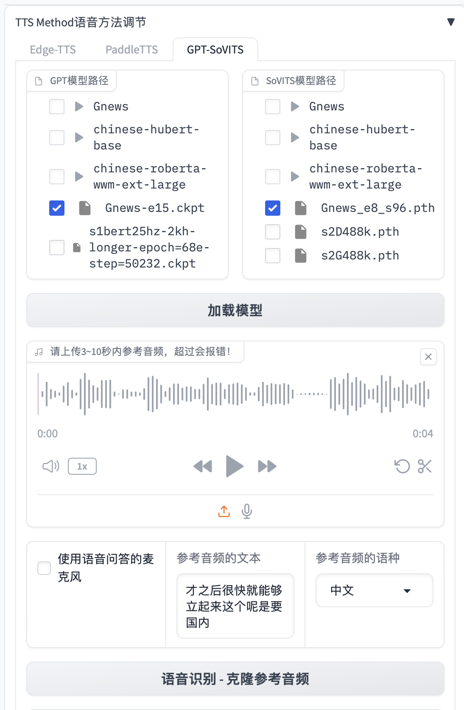
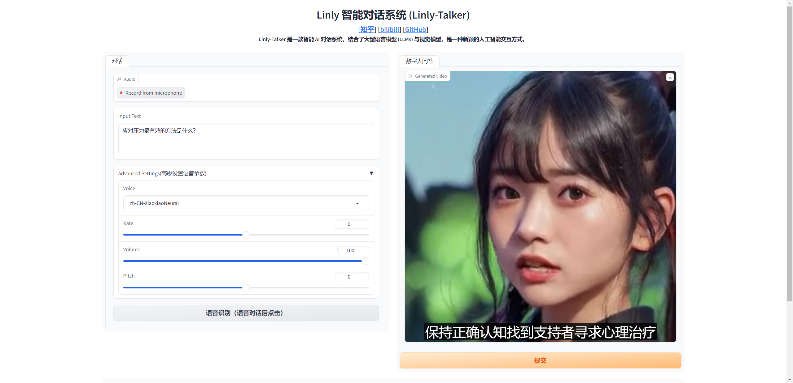
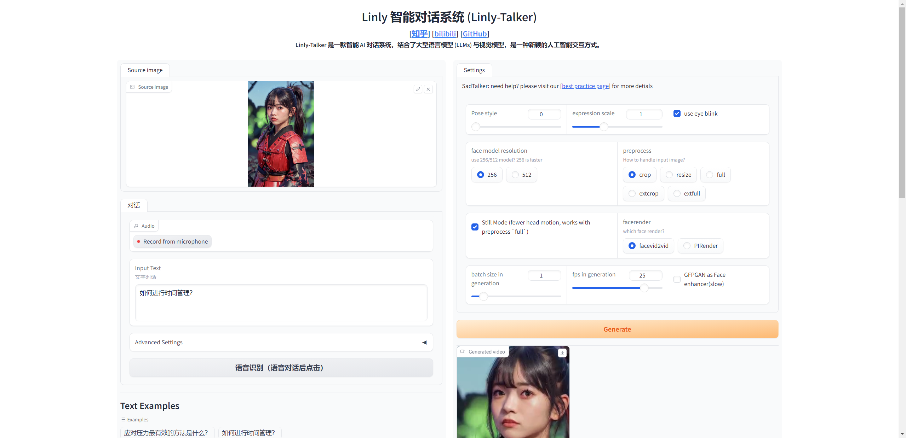
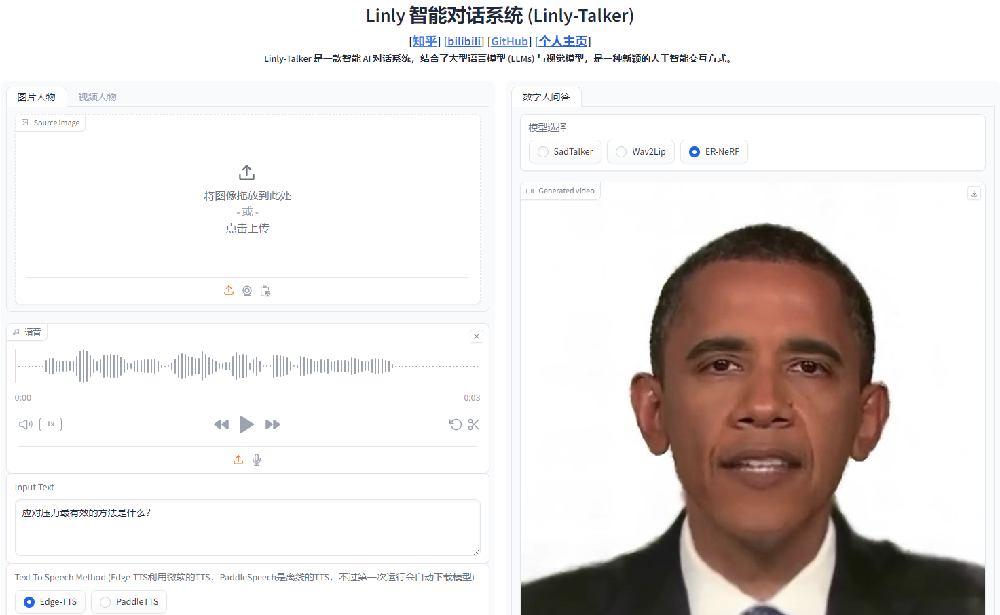
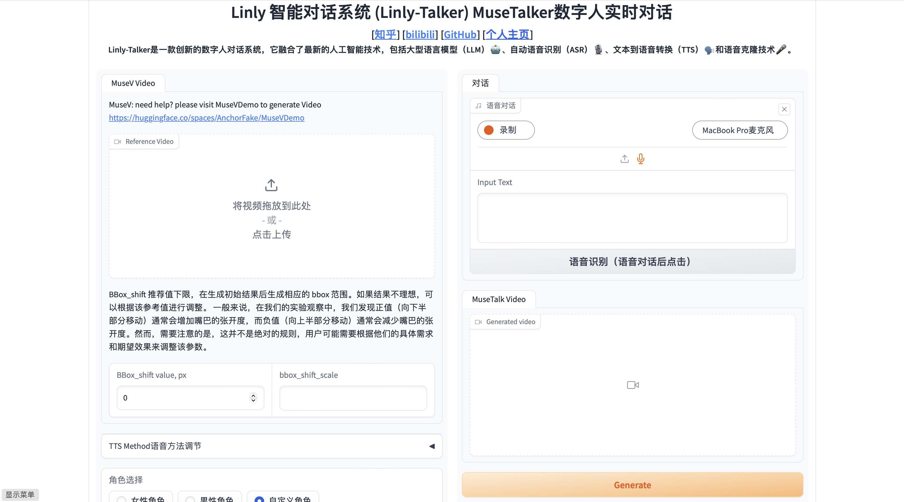

# 数字人智能对话系统 - Linly-Talker — “数字人交互，与虚拟的自己互动”

<div align="center">
<h1>Linly-Talker WebUI</h1>

[](https://github.com/Kedreamix/Linly-Talker)

<br>

[](https://colab.research.google.com/github/Kedreamix/Linly-Talker/blob/main/colab_webui.ipynb)
[](https://github.com/Kedreamix/Linly-Talker/blob/main/LICENSE)
[](https://huggingface.co/Kedreamix/Linly-Talker)

[**English**](./README.md) | [**中文简体**](./README_zh.md)

</div>

**2023.12 更新** 📆

**用户可以上传任意图片进行对话**

**2024.01 更新** 📆

- **令人兴奋的消息！我现在已经将强大的GeminiPro和Qwen大模型融入到我们的对话场景中。用户现在可以在对话中上传任何图片，为我们的互动增添了全新的层面。**
- **更新了FastAPI的部署调用方法。** 
- **更新了微软TTS的高级设置选项，增加声音种类的多样性，以及加入视频字幕加强可视化。**
- **更新了GPT多轮对话系统，使得对话有上下文联系，提高数字人的交互性和真实感。**

**2024.02 更新** 📆

- **更新了Gradio的版本为最新版本4.16.0，使得界面拥有更多的功能，比如可以摄像头拍摄图片构建数字人等。**
- **更新了ASR和THG，其中ASR加入了阿里的FunASR，具体更快的速度；THG部分加入了Wav2Lip模型，ER-NeRF在准备中(Comming Soon)。**
- **加入了语音克隆方法GPT-SoVITS模型，能够通过微调一分钟对应人的语料进行克隆，效果还是相当不错的，值得推荐。**
- **集成一个WebUI界面，能够更好的运行Linly-Talker。**

**2024.04 更新** 📆

- **更新了除 Edge TTS的 Paddle TTS的离线方式。**
- **更新了ER-NeRF作为Avatar生成的选择之一。**
- **更新了app_talk.py，在不基于对话场景可自由上传语音和图片视频生成。**

**2024.05 更新** 📆

- **更新零基础小白部署 AutoDL 教程，并且更新了codewithgpu的镜像，可以一键进行体验和学习。**
- **更新了WebUI.py，Linly-Talker WebUI支持多模块、多模型和多选项**

**2024.06 更新** 📆

- **更新MuseTalk加入Linly-Talker之中，并且更新了WebUI中，能够基本实现实时对话。**
- **改进的WebUI在默认设置下不加载LLM模型，以减少显存使用，并且可以直接通过问题回复完成口播功能。精细化后的WebUI包含以下三个主要功能：个性化角色生成、数字人多轮智能对话以及MuseTalk实时对话。这些改进不仅减少了先前的显存冗余，还增加了更多提示，以帮助用户更轻松地使用。**

**2024.08 更新** 📆

- **更新CosyVoice，具备优质的文本转语音（TTS）功能和语音克隆能力；同时更新了Wav2Lipv2，以提升整体效果**

**2024.09 更新** 📆

- **新增 Linly-Talker API 文档，提供详细的接口说明，帮助用户通过 API 使用 Linly-Talker 的功能。**

**2024.12 更新** 📆

- **简单修复了Edge-TTS的bug，解决了MuseTalk的一些问题，计划加入fishTTS以获得更稳定的TTS效果，并引入先进的数字人技术。**

**2025.02 更新** 📆

- **添加了更快的语音识别模型OmniSenseVoice。**

**2026.02 更新** 📆

- **🚀 发布 Linly-Talker-Stream：全新的实时流式交互架构版本！** 基于 WebRTC 实现低延迟音视频传输，支持全双工对话体验，实现真正的"边听边说"交互模式。
- **✋ 支持可插话可打断的自然对话：** 引入 barge-in 功能，提供更接近真人交流节奏的对话体验。
- **🧩 模块化多模态链路：** 在复用原有 ASR/LLM/TTS/Avatar 能力基础上，采用流式处理框架进行系统重构。
- **项目地址：** [Linly-Talker-Stream](https://github.com/Kedreamix/Linly-Talker-Stream) - 适合构建 AI 助手、数字人前台、互动导览等实时交互场景。

---

<details>
<summary>目录</summary>
<!-- TOC -->

- [数字人智能对话系统 - Linly-Talker — “数字人交互，与虚拟的自己互动”](#数字人智能对话系统---linly-talker--数字人交互与虚拟的自己互动)
  - [介绍](#介绍)
  - [TO DO LIST](#to-do-list)
  - [示例](#示例)
  - [创建环境](#创建环境)
  - [API 文档](#api-文档)
  - [ASR - Speech Recognition](#asr---speech-recognition)
    - [Whisper](#whisper)
    - [FunASR](#funasr)
    - [Coming Soon](#coming-soon)
  - [TTS Text To Speech](#tts-text-to-speech)
    - [Edge TTS](#edge-tts)
    - [PaddleTTS](#paddletts)
    - [Coming Soon](#coming-soon-1)
  - [Voice Clone](#voice-clone)
    - [GPT-SoVITS（推荐）](#gpt-sovits推荐)
    - [XTTS](#xtts)
    - [CosyVoice](#cosyvoice)
    - [Coming Soon](#coming-soon-2)
  - [THG - Avatar](#thg---avatar)
    - [SadTalker](#sadtalker)
    - [Wav2Lip](#wav2lip)
    - [Wav2Lipv2](#wav2lipv2)
    - [ER-NeRF](#er-nerf)
    - [MuseTalk](#musetalk)
    - [Coming Soon](#coming-soon-3)
  - [LLM - Conversation](#llm---conversation)
    - [Linly-AI](#linly-ai)
    - [Qwen](#qwen)
    - [Gemini-Pro](#gemini-pro)
    - [ChatGPT](#chatgpt)
    - [ChatGLM](#chatglm)
    - [GPT4Free](#gpt4free)
    - [LLM 多模型选择](#llm-多模型选择)
    - [Coming Soon](#coming-soon-4)
  - [优化](#优化)
  - [Gradio](#gradio)
  - [启动WebUI](#启动webui)
    - [WebUI](#webui)
    - [Old Verison](#old-verison)
  - [文件夹结构](#文件夹结构)
  - [参考](#参考)
  - [许可协议](#许可协议)
  - [Star History](#star-history)

<!-- /TOC -->

</details>

## 介绍

Linly-Talker是一款创新的数字人对话系统，它融合了最新的人工智能技术，包括大型语言模型（LLM）🤖、自动语音识别（ASR）🎙️、文本到语音转换（TTS）🗣️和语音克隆技术🎤。这个系统通过Gradio平台提供了一个交互式的Web界面，允许用户上传图片📷与AI进行个性化的对话交流💬。

系统的核心特点包括：
1. **多模型集成**：Linly-Talker整合了Linly、GeminiPro、Qwen等大模型，以及Whisper、SadTalker等视觉模型，实现了高质量的对话和视觉生成。
2. **多轮对话能力**：通过GPT模型的多轮对话系统，Linly-Talker能够理解并维持上下文相关的连贯对话，极大地提升了交互的真实感。
3. **语音克隆**：利用GPT-SoVITS等技术，用户可以上传一分钟的语音样本进行微调，系统将克隆用户的声音，使得数字人能够以用户的声音进行对话。
4. **实时互动**：系统支持实时语音识别和视频字幕，使得用户可以通过语音与数字人进行自然的交流。
5. **视觉增强**：通过数字人生成等技术，Linly-Talker能够生成逼真的数字人形象，提供更加沉浸式的体验。

Linly-Talker的设计理念是创造一种全新的人机交互方式，不仅仅是简单的问答，而是通过高度集成的技术，提供一个能够理解、响应并模拟人类交流的智能数字人。

> [!TIP]
> 
> **🚀 全新发布：Linly-Talker-Stream** 
> 
> 我们推出了 [Linly-Talker-Stream](https://github.com/Kedreamix/Linly-Talker-Stream)，这是 Linly-Talker 的实时流式交互架构版本。相比传统的"轮次式"问答，Stream 版本实现了：
> 
> - 🎤 **全双工对话**：用户讲话与数字人播放可并行进行
> - ⚡ **低延迟链路**：基于 WebRTC 的实时音视频传输
> - ✋ **可插话打断**：支持 barge-in，提供更自然的对话体验
> - 🧩 **模块化架构**：复用并扩展原有的多模态能力
> 
> 适合构建 AI 助手、数字人前台、互动导览或直播问答等实时交互场景。



> [!NOTE]
>
> 查看我们的介绍视频 [demo video](https://www.bilibili.com/video/BV1rN4y1a76x/)
>
> 在B站上我录了一系列视频，也代表我更新的每一步与使用方法，详细查看[数字人智能对话系统 - Linly-Talker合集](https://space.bilibili.com/241286257/channel/collectiondetail?sid=2065753)
>
> -  [🔥🔥🔥数字人对话系统 Linly-Talker🔥🔥🔥](https://www.bilibili.com/video/BV1rN4y1a76x/)
> - [🚀数字人的未来：Linly-Talker+GPT-SoVIT语音克隆技术的赋能之道](https://www.bilibili.com/video/BV1S4421A7gh/)
> - [AutoDL平台部署Linly-Talker (0基础小白超详细教程)](https://www.bilibili.com/video/BV1uT421m74z/)
> - [Linly-Talker 更新离线TTS集成及定制数字人方案](https://www.bilibili.com/video/BV1Mr421u7NN/)

## TO DO LIST

- [x] 基本完成对话系统流程，能够`语音对话`
- [x] 加入了LLM大模型，包括`Linly`，`Qwen`和`GeminiPro`的使用
- [x] 可上传`任意数字人照片`进行对话
- [x] Linly加入`FastAPI`调用方式
- [x] 利用微软`TTS`加入高级选项，可设置对应人声以及音调等参数，增加声音的多样性
- [x] 视频生成加入`字幕`，能够更好的进行可视化
- [x] GPT`多轮对话`系统（提高数字人的交互性和真实感，增强数字人的智能）
- [x] 优化Gradio界面，加入更多模型，如Wav2Lip，FunASR等
- [x] `语音克隆`技术，加入GPT-SoVITS，只需要一分钟的语音简单微调即可（语音克隆合成自己声音，提高数字人分身的真实感和互动体验）
- [x] 加入离线TTS以及NeRF-based的方法和模型
- [x] Linly-Talker WebUI支持多模块、多模型和多选项
- [x] 为Linly-Talker添加MuseTalk功能，基本达到实时的速度，交流速度很快
- [x] 集成MuseTalk进入Linly-Talker WebUI
- [x] 加入了CosyVoice，具备优质的文本转语音（TTS）功能和语音克隆能力。同时，更新了Wav2Lipv2，以提升图片质量效果。
- [x] 新增Linly-Talker API文档，提供详细的接口说明
- [x] `实时`语音识别:**🚀 发布 Linly-Talker-Stream**：实时流式交互架构版本，支持全双工对话、低延迟传输和可插话打断功能

> [!IMPORTANT]
>
> 🔆 该项目 Linly-Talker 正在进行中 - 欢迎提出PR请求！如果您有任何关于新的模型方法、研究、技术或发现运行错误的建议，请随时编辑并提交 PR。您也可以打开一个问题或通过电子邮件直接联系我。📩⭐ 如果您发现这个Github Project有用，请给它点个星！🤩

> [!TIP]
>
> 如果在部署的时候有任何的问题，可以关注[常见问题汇总.md](https://github.com/Kedreamix/Linly-Talker/blob/main/常见问题汇总.md)部分，我已经整理了可能出现的所有问题，另外交流群也在这里，我会定时更新，感谢大家的关注与使用！！！

## 示例

多轮 WebUI 对话支持[使用 Parallel Search MCP 联网查询](docs/Web_Search.md)，
可检索最新信息或读取网址，无需搜索服务账号或 API 密钥。
对话模型默认启用联网查询，可随时关闭；直接回复模式不会联网。

|                        文字/语音对话                         |                          数字人回答                          |
| :----------------------------------------------------------: | :----------------------------------------------------------: |
|                 应对压力最有效的方法是什么？                 | <video src="https://github.com/Kedreamix/Linly-Talker/assets/61195303/f1deb189-b682-4175-9dea-7eeb0fb392ca"></video> |
|                      如何进行时间管理？                      | <video src="https://github.com/Kedreamix/Linly-Talker/assets/61195303/968b5c43-4dce-484b-b6c6-0fd4d621ac03"></video> |
|  撰写一篇交响乐音乐会评论，讨论乐团的表演和观众的整体体验。  | <video src="https://github.com/Kedreamix/Linly-Talker/assets/61195303/f052820f-6511-4cf0-a383-daf8402630db"></video> |
| 翻译成中文：Luck is a dividend of sweat. The more you sweat, the luckier you get. | <video src="https://github.com/Kedreamix/Linly-Talker/assets/61195303/118eec13-a9f7-4c38-b4ad-044d36ba9776"></video> |

## 创建环境

> [!NOTE]
>
> AutoDL已发布镜像，可以直接使用，[https://www.codewithgpu.com/i/Kedreamix/Linly-Talker/Kedreamix-Linly-Talker](https://www.codewithgpu.com/i/Kedreamix/Linly-Talker/Kedreamix-Linly-Talker)，也可以使用docker来直接创建环境，我也会持续不断的更新镜像
>
> ```bash
> docker pull registry.cn-beijing.aliyuncs.com/codewithgpu2/kedreamix-linly-talker:afGA8RPDLf
> ```
>
> Windows我加入了一个python一键整合包，可以按顺序进行运行，按照需求按照相应的依赖，并且下载对应的模型，即可运行，主要按照conda以后从02开始安装pytorch进行运行，如果有问题，请随时与我沟通
>
> [Windows一键整合包](https://pan.quark.cn/s/cc8f19c45a15)

下载代码

```bash
git clone https://github.com/Kedreamix/Linly-Talker.git --depth 1

cd Linly-Talker
git submodule update --init --recursive
```

若使用Linly-Talker，可以直接用anaconda进行安装环境，几乎包括所有的模型所需要的依赖，具体操作如下：

```bash
conda create -n linly python=3.10
conda activate linly

# pytorch安装方式1：conda安装
# CUDA 11.8
# conda install pytorch==2.4.1 torchvision==0.19.1 torchaudio==2.4.1  pytorch-cuda=11.8 -c pytorch -c nvidia
# CUDA 12.1
# conda install pytorch==2.4.1 torchvision==0.19.1 torchaudio==2.4.1 pytorch-cuda=12.1 -c pytorch -c nvidia
# CUDA 12.4
# conda install pytorch==2.4.1 torchvision==0.19.1 torchaudio==2.4.1 pytorch-cuda=12.4 -c pytorch -c nvidia

# pytorch安装方式2：pip 安装
# CUDA 11.8
# pip install torch==2.4.1 torchvision==0.19.1 torchaudio==2.4.1 --index-url https://download.pytorch.org/whl/cu118
# CUDA 12.1
# pip install torch==2.4.1 torchvision==0.19.1 torchaudio==2.4.1 --index-url https://download.pytorch.org/whl/cu121
# CUDA 12.4
# pip install torch==2.4.1 torchvision==0.19.1 torchaudio==2.4.1 --index-url https://download.pytorch.org/whl/cu124

conda install -q ffmpeg==4.2.2 # ffmpeg==4.2.2

# 升级pip
python -m pip install --upgrade pip
# 更换 pypi 源加速库的安装
pip config set global.index-url https://pypi.tuna.tsinghua.edu.cn/simple

pip install tb-nightly -i https://mirrors.aliyun.com/pypi/simple
pip install -r requirements_webui.txt

# 安装有关musetalk依赖
pip install --no-cache-dir -U  openmim
mim install mmengine 
mim install "mmcv==2.1.0" 
mim install "mmdet>=3.1.0" 
mim install "mmpose>=1.1.0" 

# 💡CosyVoice的ttsfrd可以用WeTextProcessing代替，所以可以省略一下几步，同时保证能够在其他python版本中运行

# ⚠️注意 首先需要去下载CosyVoice-ttsfrd，需要先完成下载模型再经过这一步
# mkdir -p CosyVoice/pretrained_models # 创建文件夹 CosyVoice/pretrained_models
# mv checkpoints/CosyVoice_ckpt/CosyVoice-ttsfrd CosyVoice/pretrained_models # 移动目录
# unzip CosyVoice/pretrained_models/CosyVoice-ttsfrd/resource.zip # 解压
# 该whl库，只适用于python 3.8 的版本
# pip install CosyVoice/pretrained_models/CosyVoice-ttsfrd/ttsfrd-0.3.6-cp38-cp38-linux_x86_64.whl

# 安装NeRF-based依赖，可能问题较多，可以先放弃
pip install "git+https://github.com/facebookresearch/pytorch3d.git"
# 如果在安装pytorch3d中出现问题，可以直接运行以下命令
# python scripts/install_pytorch3d.py
pip install -r TFG/requirements_nerf.txt

# 若pyaudio出现问题，可安装对应依赖 fatal error: portaudio.h
# sudo apt-get update
# sudo apt-get install libasound-dev portaudio19-dev libportaudio2 libportaudiocpp0

# 注意以下几个模块，若安装不成功，可以进入路径利用pip install . 或者 python setup.py install编译安装
# NeRF/freqencoder
# NeRF/gridencoder
# NeRF/raymarching
# NeRF/shencoder

# If you encounter sox compatibility issues
# ubuntu
sudo apt-get install sox libsox-dev
# centos
sudo yum install sox sox-devel
```

> [!NOTE]
>
> 安装过程可能耗时很长。

以下是旧版本的一些安装方法，可能存在会一些依赖冲突的问题，但是也不会出现太多bug，但是为了更好更方便的安装，我就更新了上述版本，以下版本可以忽略，或者遇到问题可以参考一下

> 首先使用anaconda安装环境，安装pytorch环境，具体操作如下：
>
> ```bash
> conda create -n linly python=3.10  
> conda activate linly
> 
> # pytorch安装方式1：conda安装（推荐）
> conda install pytorch==1.12.1 torchvision==0.13.1 torchaudio==0.12.1 cudatoolkit=11.3 -c pytorch
> 
> # pytorch安装方式2：pip 安装
> pip install torch==1.12.1+cu113 torchvision==0.13.1+cu113 torchaudio==0.12.1 --extra-index-url https://download.pytorch.org/whl/cu113
> 
> conda install -q ffmpeg # ffmpeg==4.2.2
> 
> pip install -r requirements_app.txt
> ```
>
> 若使用语音克隆等模型，需要更高版本的Pytorch，但是功能也会更加丰富，不过需要的驱动版本可能要到cuda11.8，可选择
>
> ```bash
> conda create -n linly python=3.10  
> conda activate linly
> 
> pip install torch==2.0.1 torchvision==0.15.2 torchaudio==2.0.2 --index-url https://download.pytorch.org/whl/cu118
> 
> conda install -q ffmpeg # ffmpeg==4.2.2
> 
> pip install -r requirements_app.txt
> 
> # 安装语音克隆对应的依赖
> pip install -r VITS/requirements_gptsovits.txt
> ```
>
> 若希望使用NeRF-based等模型等话，可能需要安装一下对应的环境
>
> ```bash
> # 安装NeRF对应的依赖
> pip install "git+https://github.com/facebookresearch/pytorch3d.git"
> pip install -r TFG/requirements_nerf.txt
> 
> # 若pyaudio出现问题，可安装对应依赖
> # sudo apt-get update
> # sudo apt-get install libasound-dev portaudio19-dev libportaudio2 libportaudiocpp0
> 
> # 注意以下几个模块，若安装不成功，可以进入路径利用pip install . 或者 python setup.py install编译安装
> # NeRF/freqencoder
> # NeRF/gridencoder
> # NeRF/raymarching
> # NeRF/shencoder
> ```
>
> 若使用PaddleTTS，可安装对应的环境
>
> ```bash
> pip install -r TTS/requirements_paddle.txt
> ```
>
> 若使用FunASR语音识别模型，可安装环境
>
> ```
> pip install -r ASR/requirements_funasr.txt
> ```
>
> 若使用MuesTalk模型，可安装环境
>
> ```bash
> pip install --no-cache-dir -U openmim 
> mim install mmengine 
> mim install "mmcv>=2.0.1" 
> mim install "mmdet>=3.1.0" 
> mim install "mmpose>=1.1.0" 
> pip install -r TFG/requirements_musetalk.txt 
> ```
>


> [!NOTE]
>
> 接下来还需要安装对应的模型，有以下下载方式，下载后安装文件架结构放置，文件夹结构在本文最后有说明，建议从modelscope下载，会第一时间更新
>
> - [Baidu (百度云盘)](https://pan.baidu.com/s/1eF13O-8wyw4B3MtesctQyg?pwd=linl) (Password: `linl`)
> - [huggingface](https://huggingface.co/Kedreamix/Linly-Talker)
> - [modelscope](https://www.modelscope.cn/models/Kedreamix/Linly-Talker/summary) 
> - [Quark(夸克网盘)](https://pan.quark.cn/s/f48f5e35796b)
>

我制作一个脚本可以完成下述所有模型的下载，无需用户过多操作。这种方式适合网络稳定的情况，并且特别适合 Linux 用户。对于 Windows 用户，也可以使用 Git 来下载模型。如果网络环境不稳定，用户可以选择使用手动下载方法，或者尝试运行 Shell 脚本来完成下载。脚本具有以下功能。

1. **选择下载方式**: 用户可以选择从三种不同的源下载模型：ModelScope、Huggingface 或 Huggingface 镜像站点。
2. **下载模型**: 根据用户的选择，执行相应的下载命令。
3. **移动模型文件**: 下载完成后，将模型文件移动到指定的目录。
4. **错误处理**: 在每一步操作中加入了错误检查，如果操作失败，脚本会输出错误信息并停止执行。

```bash
sh scripts/download_models.sh
```

**HuggingFace下载**

如果速度太慢可以考虑镜像，参考 [简便快捷获取 Hugging Face 模型（使用镜像站点）](https://kedreamix.github.io/2024/01/05/Note/HuggingFace/?highlight=镜像)

```bash
# 从huggingface下载预训练模型
git lfs install
git clone https://huggingface.co/Kedreamix/Linly-Talker --depth 1
# git lfs clone https://huggingface.co/Kedreamix/Linly-Talker

# pip install -U huggingface_hub
# export HF_ENDPOINT=https://hf-mirror.com # 使用镜像网站
huggingface-cli download --resume-download --local-dir-use-symlinks False Kedreamix/Linly-Talker --local-dir Linly-Talker
```

**ModelScope下载**

```bash
# 从modelscope下载预训练模型
# 1. git 方法
git lfs install
git clone https://www.modelscope.cn/Kedreamix/Linly-Talker.git --depth 1
# git lfs clone https://www.modelscope.cn/Kedreamix/Linly-Talker.git --depth 1

# 2. Python 代码下载
pip install modelscope
from modelscope import snapshot_download
model_dir = snapshot_download('Kedreamix/Linly-Talker', resume_download=True, cache_dir='./', revision='master')
```

**移动所有模型到当前目录**

如果百度网盘下载后，可以参考文档最后目录结构来移动目录

```bash
# 移动所有模型到当前目录
# checkpoint中含有SadTalker和Wav2Lip等权重
mv Linly-Talker/checkpoints/* ./checkpoints

# 若使用GFPGAN增强，安装对应的库
# pip install gfpgan
# mv Linly-Talker/gfpan ./

# 语音克隆模型
mv Linly-Talker/GPT_SoVITS/pretrained_models/* ./GPT_SoVITS/pretrained_models/

# Qwen大模型
mv Linly-Talker/Qwen ./

# MuseTalk模型
mkdir -p ./Musetalk/models
mv Linly-Talker/MuseTalk/* ./Musetalk/models
```

为了大家的部署使用方便，更新了一个`configs.py`文件，可以对其进行一些超参数修改即可

```bash
# 设备运行端口 (Device running port)
port = 6006

# api运行端口及IP (API running port and IP)
mode = 'api' # api 需要先运行Linly-api-fast.py，暂时仅仅适用于Linly

# 本地端口localhost:127.0.0.1 全局端口转发:"0.0.0.0"
ip = '127.0.0.1' 
api_port = 7871

# LLM模型路径 (Linly model path)
mode = 'offline'
model_path = 'Qwen/Qwen-1_8B-Chat'

# ssl证书 (SSL certificate) 麦克风对话需要此参数
# 最好调整为绝对路径
ssl_certfile = "./https_cert/cert.pem"
ssl_keyfile = "./https_cert/key.pem"
```


## API 文档

在 [api/README.md](api/README.md) 文件中，我们详细介绍了 Linly-Talker API 的使用和配置。这些文档为用户提供了关于如何调用 API、所需的参数、返回的数据格式等信息。通过查阅这些文档，用户可以深入了解如何通过 API 接口来实现 Linly-Talker 的功能，包括启动对话、上传图片、进行语音识别和生成语音等操作。

要获得这些详细的 API 接口说明，请访问 `api/README.md` 文件。


## ASR - Speech Recognition

详细有关于语音识别的**使用介绍**与**代码实现**可见 [ASR - 同数字人沟通的桥梁](./ASR/README.md)

### Whisper

借鉴OpenAI的Whisper实现了ASR的语音识别，具体使用方法参考 [https://github.com/openai/whisper](https://github.com/openai/whisper)

### FunASR

阿里的`FunASR`的语音识别效果也是相当不错，而且时间也是比whisper更快的，对中文实际上是更好的。

同时funasr更能达到实时的效果，所以也将FunASR添加进去了，在ASR文件夹下的FunASR文件里可以进行体验，参考 [https://github.com/alibaba-damo-academy/FunASR](https://github.com/alibaba-damo-academy/FunASR)。


### Coming Soon

欢迎大家提出建议，激励我不断更新模型，丰富Linly-Talker的功能。

## TTS Text To Speech

详细有关于语音识别的**使用介绍**与**代码实现**可见 [TTS - 赋予数字人真实的语音交互能力](./TTS/README.md)

### Edge TTS

借鉴使用微软语音服务，具体使用方法参考[https://github.com/rany2/edge-tts](https://github.com/rany2/edge-tts)

> [!Warning]
>
> 由于Edge TTS仓库出现了一些问题，似乎是因为微软对某些IP进行了限制，可参考[403 error is back/need to implement Sec-MS-GEC token](https://github.com/rany2/edge-tts/issues/290) [Add support for clock adjustment for Sec-MS-GEC token](https://github.com/rany2/edge-tts/pull/309)，暂时发现还是不稳定，我有进行修改，若感觉还是不稳定，请使用其他方法，推荐使用CosyVoice方法


### PaddleTTS

在实际使用过程中，可能会遇到需要离线操作的情况。由于Edge TTS需要在线环境才能生成语音，因此我们选择了同样开源的PaddleSpeech作为文本到语音（TTS）的替代方案。虽然效果可能有所不同，但PaddleSpeech支持离线操作。更多信息可参考PaddleSpeech的GitHub页面：[PaddleSpeech](https://github.com/PaddlePaddle/PaddleSpeech)。


### Coming Soon

欢迎大家提出建议，激励我不断更新模型，丰富Linly-Talker的功能。


## Voice Clone

详细有关于语音克隆的**使用介绍**与**代码实现**可见 [Voice Clone - 在对话时悄悄偷走你的声音](./VITS/README.md)

### GPT-SoVITS（推荐）

感谢大家的开源贡献，我借鉴了当前开源的语音克隆模型 `GPT-SoVITS`，我认为效果是相当不错的，项目地址可参考[https://github.com/RVC-Boss/GPT-SoVITS](https://github.com/RVC-Boss/GPT-SoVITS)

我将一些训练好的克隆权重放在了[Quark(夸克网盘)](https://pan.quark.cn/s/f48f5e35796b)中，大家可以自取权重和参考音频。


### XTTS

Coqui XTTS是一个领先的深度学习文本到语音任务（TTS语音生成模型）工具包，通过使用一段5秒钟以上的语音频剪辑就可以完成声音克隆*将语音克隆到不同的语言*。

🐸TTS 是一个用于高级文本转语音生成的库。

🚀 超过 1100 种语言的预训练模型。

🛠️ 用于以任何语言训练新模型和微调现有模型的工具。

📚 用于数据集分析和管理的实用程序。

- 在线体验XTTS [https://huggingface.co/spaces/coqui/xtts](https://huggingface.co/spaces/coqui/xtts)
- 官方Github库 https://github.com/coqui-ai/TTS


### CosyVoice

CosyVoice 是阿里通义实验室开源的一款多语言语音理解模型，专注于高质量的语音合成。该模型经过超过15万小时的数据训练，支持中文、英语、日语、粤语和韩语等多种语言的语音合成。CosyVoice 在多语言语音生成、零样本语音生成、跨语言声音合成和指令执行能力等方面表现出色。

CosyVoice 支持 one-shot 音色克隆技术，仅需3至10秒的原始音频即可生成逼真自然的模拟音色，包括韵律和情感等细节。

GitHub项目地址：https://github.com/FunAudioLLM/CosyVoice

CosyVoice 包含多个预训练的语音合成模型，主要包括：

1. **CosyVoice-300M**：支持中、英、日、粤、韩等多语言的零样本（zero-shot）和跨语言（cross-lingual）语音合成。
2. **CosyVoice-300M-SFT**：专注于监督微调（SFT）推理的模型。
3. **CosyVoice-300M-Instruct**：支持指令推理的模型，可以生成包含特定语气、情感等元素的语音。

主要功能和特性

1. **多语言支持**：能够处理多种语言，包括中文、英语、日语、粤语和韩语等。
2. **多风格语音合成**：通过指令可以控制生成语音的语气和情感。
3. **流式推理支持**：未来将支持流式推理模式，包括KV缓存和SDPA等用于实时性优化的技术。

暂时 Linly-Talker 中加入了 预训练音色、3s极速复刻 和  跨语种复刻 三种功能，更多有趣的可以继续关注 Linly-Talker，以下是CosyVoice的一些效果

<table>
<tr>
<th></th>
<th align="center">PROMPT TEXT</th>
<th align="center">PROMPT SPEECH</th>
<th align="center">TARGET TEXT</th>
<th align="center">RESULT</th>
</tr>
<tr>
<td align="center"><strong>预训练音色</strong></td>
<td align="center">中文女 音色（'中文女', '中文男', '日语男', '粤语女', '英文女', '英文男', '韩语女'）</td>
<td align="center">—</td>
<td align="center">你好，我是通义生成式语音大模型，请问有什么可以帮您的吗？</td>
<td align="center">

[sft.webm](https://github.com/user-attachments/assets/a9f9c8c4-7137-4845-9adb-a93ac304131e)

</td>
</tr>
<tr>
<td align="center"><strong>3s语言复刻</strong></td>
<td align="center">希望你以后能够做的比我还好呦。</td>
<td align="center">

[zero_shot_prompt.webm](https://github.com/user-attachments/assets/1ef09db6-42e5-42d2-acc2-d44e70b147f9)
</td>
<td align="center">收到好友从远方寄来的生日礼物，那份意外的惊喜与深深的祝福让我心中充满了甜蜜的快乐，笑容如花儿般绽放。</td>
<td align="center">

[zero_shot.webm](https://github.com/user-attachments/assets/ba46c58f-2e16-4440-b920-51ec288f09e6)
</td>
</tr>
<tr>
<td align="center"><strong>跨语种复刻</strong></td>
<td align="center">在那之后，完全收购那家公司，因此保持管理层的一致性，利益与即将加入家族的资产保持一致。这就是我们有时不买下全部的原因。</td>
<td align="center">

[cross_lingual_prompt.webm](https://github.com/user-attachments/assets/378ae5e6-b52a-47b4-b0db-d84d1edd6e56)
</td>
<td align="center">
&lt; |en|&gt;And then later on, fully acquiring that company. So keeping management in line, interest in line with the asset that's coming into the family is a reason why sometimes we don't buy the whole thing.
</td>
<td align="center">

[cross_lingual.webm](https://github.com/user-attachments/assets/b0162fc8-5738-4642-9fdd-b388a4965546)
</td>
</tr>
</table>


### Coming Soon

欢迎大家提出建议，激励我不断更新模型，丰富Linly-Talker的功能。


## THG - Avatar

详细有关于数字人生成的**使用介绍**与**代码实现**可见 [THG - 构建智能数字人](./TFG/README.md)

### SadTalker

数字人生成可使用SadTalker（CVPR 2023）,详情介绍见 [https://sadtalker.github.io](https://sadtalker.github.io)

在使用前先下载SadTalker模型:

```bash
bash scripts/sadtalker_download_models.sh  
```

[Baidu (百度云盘)](https://pan.baidu.com/s/1eF13O-8wyw4B3MtesctQyg?pwd=linl) (Password: `linl`)

[Quark(夸克网盘)](https://pan.quark.cn/s/f48f5e35796b)

> 如果百度网盘下载，记住是放在checkpoints文件夹下，百度网盘下载的默认命名为sadtalker，实际应该重命名为checkpoints

### Wav2Lip

数字人生成还可使用Wav2Lip（ACM 2020），详情介绍见 [https://github.com/Rudrabha/Wav2Lip](https://github.com/Rudrabha/Wav2Lip)

在使用前先下载Wav2Lip模型：

| Model                        | Description                                           | Link to the model                                            |
| ---------------------------- | ----------------------------------------------------- | ------------------------------------------------------------ |
| Wav2Lip                      | Highly accurate lip-sync                              | [Link](https://iiitaphyd-my.sharepoint.com/:u:/g/personal/radrabha_m_research_iiit_ac_in/Eb3LEzbfuKlJiR600lQWRxgBIY27JZg80f7V9jtMfbNDaQ?e=TBFBVW) |
| Wav2Lip + GAN                | Slightly inferior lip-sync, but better visual quality | [Link](https://iiitaphyd-my.sharepoint.com/:u:/g/personal/radrabha_m_research_iiit_ac_in/EdjI7bZlgApMqsVoEUUXpLsBxqXbn5z8VTmoxp55YNDcIA?e=n9ljGW) |
| Expert Discriminator         | Weights of the expert discriminator                   | [Link](https://iiitaphyd-my.sharepoint.com/:u:/g/personal/radrabha_m_research_iiit_ac_in/EQRvmiZg-HRAjvI6zqN9eTEBP74KefynCwPWVmF57l-AYA?e=ZRPHKP) |
| Visual Quality Discriminator | Weights of the visual disc trained in a GAN setup     | [Link](https://iiitaphyd-my.sharepoint.com/:u:/g/personal/radrabha_m_research_iiit_ac_in/EQVqH88dTm1HjlK11eNba5gBbn15WMS0B0EZbDBttqrqkg?e=ic0ljo) |

### Wav2Lipv2

借鉴于 https://github.com/primepake/wav2lip_288x288 仓库，使用新训练的288模型，能够得到更高质量的结果

同时使用yolo进行检测面部，整体的效果都会更好一点，具体可以在Linly-Talker中进行比较和测试，模型已更新，效果比较如下

| Wav2Lip                                                      | Wav2Lipv2                                                    |
| ------------------------------------------------------------ | ------------------------------------------------------------ |
| <video src="https://github.com/user-attachments/assets/d61df5cf-e3b9-4057-81fc-d69dcff806d6"></video> | <video src="https://github.com/user-attachments/assets/7f6be271-2a4d-4d9c-98f8-db25816c28b3"></video> |


### ER-NeRF

ER-NeRF（ICCV2023）是使用最新的NeRF技术构建的数字人，拥有定制数字人的特性，只需要一个人的五分钟左右到视频即可重建出来，具体可参考 [https://github.com/Fictionarry/ER-NeRF](https://github.com/Fictionarry/ER-NeRF)

已更新，以奥巴马形象作为参考，若考虑更好的效果，可能考虑克隆定制数字人的声音以得到更好的效果。


### MuseTalk

MuseTalk 是一个实时高质量的音频驱动唇形同步模型，能够以30帧每秒以上的速度在NVIDIA Tesla V100显卡上运行。该模型可以与由 MuseV 生成的输入视频结合使用，作为完整的虚拟人解决方案的一部分。具体可参考 [https://github.com/TMElyralab/MuseTalk](https://github.com/TMElyralab/MuseTalk)

MuseTalk 是一个实时高质量的音频驱动唇形同步模型，经过训练可以在 ft-mse-vae 的潜在空间中进行工作。它具有以下特性：

- **未见面孔的同步**：根据输入的音频对未见过的面孔进行修改，面部区域的大小为 256 x 256。
- **多语言支持**：支持多种语言的音频输入，包括中文、英语和日语。
- **高性能实时推理**：在 NVIDIA Tesla V100 上可以实现 30帧每秒以上的实时推理。
- **面部中心点调整**：支持修改面部区域的中心点位置，这对生成结果有显著影响。
- **HDTF 数据集训练**：提供在 HDTF 数据集上训练的模型检查点。
- **训练代码即将发布**：训练代码即将发布，方便进一步的开发和研究。

MuseTalk 提供了一个高效且灵活的工具，使虚拟人的面部表情能够精确同步于音频，为实现全方位互动的虚拟人迈出了重要一步。

在Linly-Talker中已经加入了MuseTalk，基于MuseV的视频进行推理，得到了比较理想的速度进行对话，基本达到实时的效果，还是非常不错的，也是可以基于流式进行推理的。


### Coming Soon

欢迎大家提出建议，激励我不断更新模型，丰富Linly-Talker的功能。


## LLM - Conversation

详细有关于大模型的**使用介绍**与**代码实现**可见 [LLM - 大语言模型为数字人赋能](./LLM/README.md)

### Linly-AI

Linly来自深圳大学数据工程国家重点实验室，参考 [https://github.com/CVI-SZU/Linly](https://github.com/CVI-SZU/Linly)


### Qwen

来自阿里云的Qwen，查看 [https://github.com/QwenLM/Qwen](https://github.com/QwenLM/Qwen)

如果想要快速使用，可以选1.8B的模型，参数比较少，在较小的显存也可以正常使用，当然这一部分可以替换

下载 Qwen1.8B 模型: [https://huggingface.co/Qwen/Qwen-1_8B-Chat](https://huggingface.co/Qwen/Qwen-1_8B-Chat)


### Gemini-Pro

来自 Google 的 Gemini-Pro，了解更多请访问 [https://deepmind.google/technologies/gemini/](https://deepmind.google/technologies/gemini/)

请求 API 密钥: [https://makersuite.google.com/](https://makersuite.google.com/)


### ChatGPT

来自OpenAI的，需要申请API，了解更多请访问 [https://platform.openai.com/docs/introduction](https://platform.openai.com/docs/introduction)


### ChatGLM

来自清华的，了解更多请访问 [https://github.com/THUDM/ChatGLM3](https://github.com/THUDM/ChatGLM3)


### GPT4Free

可参考[https://github.com/xtekky/gpt4free](https://github.com/xtekky/gpt4free)，免费白嫖使用GPT4等模型


### LLM 多模型选择

在 webui.py 文件中，轻松选择您需要的模型，⚠️第一次运行要先下载模型，参考Qwen1.8B


### Coming Soon

欢迎大家提出建议，激励我不断更新模型，丰富Linly-Talker的功能。


## 优化

一些优化:

- 使用固定的输入人脸图像,提前提取特征,避免每次读取

- 移除不必要的库,缩短总时间

- 只保存最终视频输出,不保存中间结果,提高性能

- 使用OpenCV生成最终视频,比mimwrite更快

  

## Gradio

Gradio是一个Python库,提供了一种简单的方式将机器学习模型作为交互式Web应用程序来部署。

对Linly-Talker而言,使用Gradio有两个主要目的:

1. **可视化与演示**:Gradio为模型提供一个简单的Web GUI,上传图片和文本后可以直观地看到结果。这是展示系统能力的有效方式。

2. **用户交互**:Gradio的GUI可以作为前端,允许用户与Linly-Talker进行交互对话。用户可以上传自己的图片并输入问题,实时获取回答。这提供了更自然的语音交互方式。

具体来说,我们在app.py中创建了一个Gradio的Interface,接收图片和文本输入,调用函数生成回应视频,在GUI中显示出来。这样就实现了浏览器交互而不需要编写复杂的前端。

总之,Gradio为Linly-Talker提供了可视化和用户交互的接口,是展示系统功能和让最终用户使用系统的有效途径。

> 若考虑实时对话，可能需要换个框架，或者对Gradio进行魔改，希望和大家一起努力

## 启动WebUI

之前我将很多个版本都是分开来的，实际上运行多个会比较麻烦，所以后续我增加了变成WebUI一个界面即可体验，后续也会不断更新

### WebUI

现在已加入WebUI的功能如下

- [x] 文本/语音数字人对话（固定数字人，分男女角色）

- [x] 任意图片数字人对话（可上传任意图片数字人）

- [x] 多轮GPT对话（加入历史对话数据，链接上下文）

- [x] 语音克隆对话（基于GPT-SoVITS设置进行语音克隆，也可根据语音对话的声音进行克隆）

- [x] 数字人文本/语音播报（根据输入的文字/语音进行播报）

- [x] 多模块➕多模型➕多选择

  - [x] 角色多选择：女性角色/男性角色/自定义角色(每一部分都可以自动上传图片)/Comming Soon
  - [x] TTS模型多选择：EdgeTTS / PaddleTTS/ GPT-SoVITS/CosyVoice/Comming Soon
  - [x] LLM模型多选择： Linly/ Qwen / ChatGLM/ GeminiPro/ ChatGPT/Comming Soon
  - [x] Talker模型多选择：Wav2Lip/ Wav2Lipv2/ SadTalker/ ERNeRF/ MuseTalk/Comming Soon
  - [x] ASR模型多选择：Whisper/ FunASR/Comming Soon

  

可以直接运行webui来得到结果，可以看到的页面如下

```bash
# WebUI
python webui.py
```


这次更新了一下界面，我们可以自由选择GPT-SoVITS微调后的模型来实现，上传参考音频即可很好的克隆声音




### Old Verison

> 这一部分是为了保证每部份代码都是正确的，所以会先对每一个模块都进行测试和改进

启动一共有几种模式，可以选择特定的场景进行设置

第一种只有固定了人物问答，设置好了人物，省去了预处理时间

```bash
python app.py
```



最近更新了第一种模式，加入了Wav2Lip模型进行对话

```bash
python appv2.py
```

第二种是可以任意上传图片进行对话

```bash
python app_img.py
```



第三种是在第一种的基础上加入了大语言模型，加入了多轮的GPT对话

```bash
python app_multi.py
```


现在加入了语音克隆的部分，可以自由切换自己克隆的声音模型和对应的人图片进行实现，这里我选择了一个烟嗓音和男生图片

```bash
python app_vits.py
```

加入了第四种方式，不固定场景进行对话，直接输入语音或者生成语音进行数字人生成，内置了Sadtalker，Wav2Lip，ER-NeRF等方式

> ER-NeRF是针对单独一个人的视频进行训练的，所以需要替换特定的模型才能进行渲染得到正确的结果，内置了Obama的权重，可直接用

```bash
python app_talk.py
```



加入了MuseTalk的方式，能够将MuseV的视频进行预处理，预处理后进行对话，速度基本能够达到实时的要求，速度非常快，MuseTalk已加入在WebUI中。

```bash
python app_musetalk.py
```



## 文件夹结构

> [!NOTE]
>
> 所有的权重部分可以从这下载，百度网盘可能有时候会更新慢一点，建议从夸克网盘下载，会第一时间更新
>
> - [Baidu (百度云盘)](https://pan.baidu.com/s/1eF13O-8wyw4B3MtesctQyg?pwd=linl) (Password: `linl`)
> - [huggingface](https://huggingface.co/Kedreamix/Linly-Talker)
> - [modelscope](https://www.modelscope.cn/models/Kedreamix/Linly-Talker/files)
> - [Quark(夸克网盘)](https://pan.quark.cn/s/f48f5e35796b)
>

权重文件夹结构如下

```bash
Linly-Talker/ 
├── checkpoints
│   ├── audio_visual_encoder.pth
│   ├── hub
│   │   └── checkpoints
│   │       └── s3fd-619a316812.pth
│   ├── lipsync_expert.pth
│   ├── mapping_00109-model.pth.tar
│   ├── mapping_00229-model.pth.tar
│   ├── May.json
│   ├── May.pth
│   ├── Obama_ave.pth
│   ├── Obama.json
│   ├── Obama.pth
│   ├── ref_eo.npy
│   ├── ref.npy
│   ├── ref.wav
│   ├── SadTalker_V0.0.2_256.safetensors
│   ├── visual_quality_disc.pth
│   ├── wav2lip_gan.pth
│   └── wav2lip.pth
├── gfpgan
│   └── weights
│       ├── alignment_WFLW_4HG.pth
│       └── detection_Resnet50_Final.pth
├── GPT_SoVITS
│   └── pretrained_models
│       ├── chinese-hubert-base
│       │   ├── config.json
│       │   ├── preprocessor_config.json
│       │   └── pytorch_model.bin
│       ├── chinese-roberta-wwm-ext-large
│       │   ├── config.json
│       │   ├── pytorch_model.bin
│       │   └── tokenizer.json
│       ├── README.md
│       ├── s1bert25hz-2kh-longer-epoch=68e-step=50232.ckpt
│       ├── s2D488k.pth
│       ├── s2G488k.pth
│       └── speech_paraformer-large_asr_nat-zh-cn-16k-common-vocab8404-pytorch

├── MuseTalk
│   ├── models
│   │   ├── dwpose
│   │   │   └── dw-ll_ucoco_384.pth
│   │   ├── face-parse-bisent
│   │   │   ├── 79999_iter.pth
│   │   │   └── resnet18-5c106cde.pth
│   │   ├── musetalk
│   │   │   ├── musetalk.json
│   │   │   └── pytorch_model.bin
│   │   ├── README.md
│   │   ├── sd-vae-ft-mse
│   │   │   ├── config.json
│   │   │   └── diffusion_pytorch_model.bin
│   │   └── whisper
│   │       └── tiny.pt
├── Qwen
│   └── Qwen-1_8B-Chat
│       ├── assets
│       │   ├── logo.jpg
│       │   ├── qwen_tokenizer.png
│       │   ├── react_showcase_001.png
│       │   ├── react_showcase_002.png
│       │   └── wechat.png
│       ├── cache_autogptq_cuda_256.cpp
│       ├── cache_autogptq_cuda_kernel_256.cu
│       ├── config.json
│       ├── configuration_qwen.py
│       ├── cpp_kernels.py
│       ├── examples
│       │   └── react_prompt.md
│       ├── generation_config.json
│       ├── LICENSE
│       ├── model-00001-of-00002.safetensors
│       ├── model-00002-of-00002.safetensors
│       ├── modeling_qwen.py
│       ├── model.safetensors.index.json
│       ├── NOTICE
│       ├── qwen_generation_utils.py
│       ├── qwen.tiktoken
│       ├── README.md
│       ├── tokenization_qwen.py
│       └── tokenizer_config.json
├── Whisper
│   ├── base.pt
│   └── tiny.pt
├── FunASR
│   ├── punc_ct-transformer_zh-cn-common-vocab272727-pytorch
│   │   ├── configuration.json
│   │   ├── config.yaml
│   │   ├── example
│   │   │   └── punc_example.txt
│   │   ├── fig
│   │   │   └── struct.png
│   │   ├── model.pt
│   │   ├── README.md
│   │   └── tokens.json
│   ├── speech_fsmn_vad_zh-cn-16k-common-pytorch
│   │   ├── am.mvn
│   │   ├── configuration.json
│   │   ├── config.yaml
│   │   ├── example
│   │   │   └── vad_example.wav
│   │   ├── fig
│   │   │   └── struct.png
│   │   ├── model.pt
│   │   └── README.md
│   └── speech_seaco_paraformer_large_asr_nat-zh-cn-16k-common-vocab8404-pytorch
│       ├── am.mvn
│       ├── asr_example_hotword.wav
│       ├── configuration.json
│       ├── config.yaml
│       ├── example
│       │   ├── asr_example.wav
│       │   └── hotword.txt
│       ├── fig
│       │   ├── res.png
│       │   └── seaco.png
│       ├── model.pt
│       ├── README.md
│       ├── seg_dict
│       └── tokens.json
└── README.md
```

## 参考

**ASR**

- [https://github.com/openai/whisper](https://github.com/openai/whisper)
- [https://github.com/alibaba-damo-academy/FunASR](https://github.com/alibaba-damo-academy/FunASR)

**TTS**

- [https://github.com/rany2/edge-tts](https://github.com/rany2/edge-tts)  
- [https://github.com/PaddlePaddle/PaddleSpeech](https://github.com/PaddlePaddle/PaddleSpeech)

**LLM**

- [https://github.com/CVI-SZU/Linly](https://github.com/CVI-SZU/Linly)
- [https://github.com/QwenLM/Qwen](https://github.com/QwenLM/Qwen)
- [https://deepmind.google/technologies/gemini/](https://deepmind.google/technologies/gemini/)
- [https://github.com/THUDM/ChatGLM3](https://github.com/THUDM/ChatGLM3)
- [https://openai.com](https://openai.com)

**THG**

- [https://github.com/OpenTalker/SadTalker](https://github.com/OpenTalker/SadTalker)
- [https://github.com/Rudrabha/Wav2Lip](https://github.com/Rudrabha/Wav2Lip)
- [https://github.com/Fictionarry/ER-NeRF](https://github.com/Fictionarry/ER-NeRF)

**Voice Clone**

- [https://github.com/RVC-Boss/GPT-SoVITS](https://github.com/RVC-Boss/GPT-SoVITS)
- [https://github.com/coqui-ai/TTS](https://github.com/coqui-ai/TTS)

**实时流式版本**

- [Linly-Talker-Stream](https://github.com/Kedreamix/Linly-Talker-Stream) - 实时流式交互架构版本


## 许可协议

> [!CAUTION]
>
> 在使用本工具时，请遵守相关法律，包括版权法、数据保护法和隐私法。未经原作者和/或版权所有者许可，请勿使用本工具。

`Linly-Talker` 遵循 MIT Licence。在使用本工具时，请遵守相关法律，包括版权法、数据保护法和隐私法。未经原作者和/或版权所有者许可，请勿使用本工具。未经原作者和/或版权所有者许可，请勿使用本工具。此外，请确保遵守您参考的模型和组件中的所有许可协议。

## Star History

[](https://star-history.com/#Kedreamix/Linly-Talker&Date)

